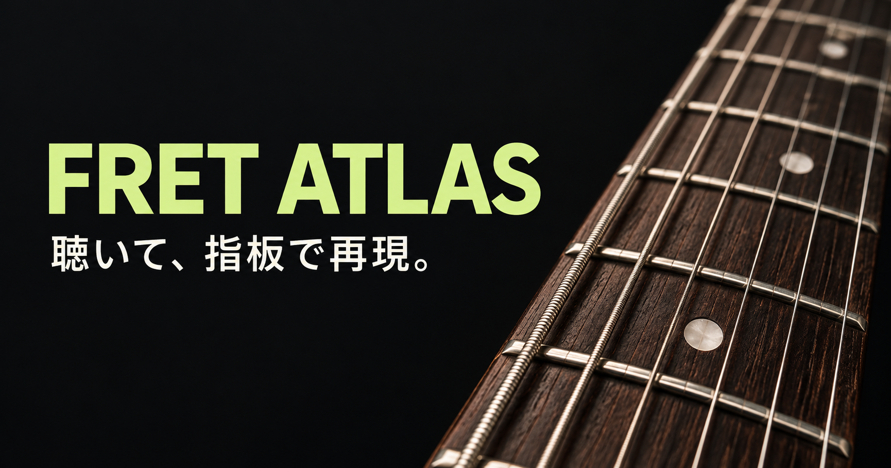

# オトアテ

**聴いて、指板で再現。** ギターが手元になくてもできる、日本語の耳コピトレーニング。

**[オトアテを開く](https://amashimacreate.github.io/otoate/)**



## できること

- 1音・2音・3音・4音のランダム出題。音数と難易度は別々に選べます。
- 難易度は「かんたん・ふつう・むずかしい」の3段階。練習画面から切り替えられます。
- 標準チューニング、開放弦〜22フレット。指板の拡大／全体表示。
- 指板をタップするだけで回答枠が次へ進む連続入力。
- お題と回答の聴き比べ、回答の再生、入力を1つ戻す操作。
- ○／×と音ごとの判定。同じ高さなら別の弦でも正解、オクターブ違いは別の音。
- 音量・再生速度を設定。スマートフォンでも操作可能。

「お題を聴く」→ 指板で音を選ぶ →「答え合わせ」。1音はお題を聴いた後のタップで即判定します。指板上の矢印キーで移動、Enterで入力、Spaceでお題の再生、Backspaceで1つ戻す、Escで再生を停止できます。

## 難易度

2〜4音のお題では、実際に鳴る最低音から最高音までの幅を変えます。

| 難易度 | 1問の音域の幅 |
| --- | --- |
| かんたん | 1〜12半音（1オクターブ以内） |
| ふつう（初期設定） | 13〜24半音（1オクターブ超〜2オクターブ） |
| むずかしい | 25〜46半音（2オクターブ超） |

各問題に最低音と最高音を必ず含めるため、ふつう・むずかしいで1オクターブ以内に収まる問題は出ません。どの難易度もE2〜D6から出題し、全6弦・0〜22Fの指板を使います。1音では問題内の音域幅がないため、難易度によらずE2〜D6の全47音からランダムに出題します。

難易度を変えると新しいお題に切り替わります。音数、指板の表示、正解数は維持します。

## データとサウンド

サウンドはWeb Audio APIによる弦の合成音です。録音素材や外部音源サービスは使いません。再生にはブラウザでのユーザー操作が必要です。

練習設定は端末の `localStorage` に保存します。耳コピの正解数は練習中のみ保持します。ログイン、クラウド同期、アクセス解析のコードはありません。端末やブラウザを変えると記録は共有されません。

## ローカルで開く

Node.js 24以上とPython 3を使用します。npmパッケージのインストールは不要です。

```sh
npm run dev
```

開発中の耳コピ画面: <http://127.0.0.1:4178/ear.html>

公開時と同じ構成を確認する場合:

```sh
npm run build
npm run preview
```

<http://127.0.0.1:4181/> で耳コピ画面が開きます。`dist/` が編集元、`_site/` が公開用出力です。ビルド時に耳コピをトップページに配置します。

## テストと公開

```sh
npm test
npm run check
npm run build
```

`main` にpushすると、GitHub Actionsがテスト・構文チェック・ビルドを行い、成功した場合にGitHub Pagesへ公開します。公開URLはPages設定から取得してOGP・canonical・サイトマップに反映します。独自ドメインなどで手動ビルドする場合は `SITE_URL=https://example.com/ npm run build` と指定できます。

主なファイル:

- `dist/ear.html` / `ear.css` / `ear.js`: 耳コピ画面と操作
- `dist/ear-model.js`: 出題と採点
- `dist/ear-playback.js`: キャンセル可能な連続再生
- `dist/ear-preferences.js`: 設定の検証と保存
- `dist/audio.js`: ギターの合成音
- `dist/pitch.js`: 標準チューニングの音高計算
- `scripts/build.mjs`: 公開用ルーティングと共有メタデータ
- `.github/workflows/pages.yml`: 検証と自動公開

## ビジュアル素材

共有用サムネイルは画像生成で作成しました。制作方法とプロンプトは [assets-source/thumbnail-prompt.md](assets-source/thumbnail-prompt.md) にあります。ファビコンはこのプロジェクト用のSVGです。

操作アイコンは [Phosphor Icons](https://phosphoricons.com/) を利用しています。MITライセンスの表示は [dist/ear-icons/LICENSE](dist/ear-icons/LICENSE) に含めています。
